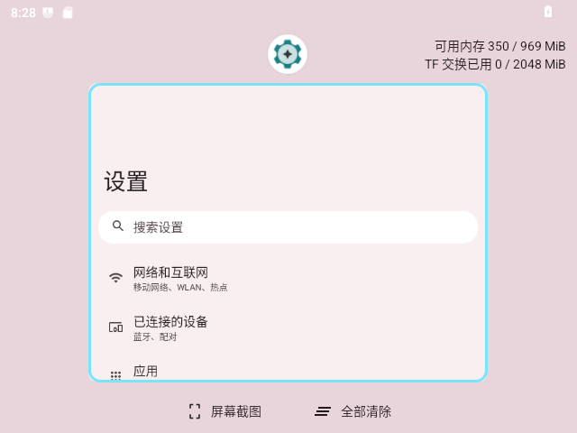

# 桌面、手柄与游戏兼容性

## 桌面和最近任务

Windows 助手生成的镜像预装 AT4K 1.2，使用 H700 默认壁纸。最近任务由 Trebuchet / Quickstep 提供。在「设置 → 应用 → 默认应用 → 主屏幕应用」可以更换桌面。

- 首次开机已启用「Pixel 2 手柄导航」，右侧三键导航栏默认隐藏。可在「设置 → 无障碍」关闭或重新启用手柄服务。先按 R1，再在约 0.16 秒内点功能键，十字键选择，A 确认，B 返回。单独使用 R1 仍可操作游戏。
- 最近任务用左右切换应用，A 打开，X 关闭所选任务，B 退出。切到 Trebuchet 主屏时，它会同步可启动的应用。
- 面板每两秒刷新。第一行是物理内存的可用量 / 总量，使用内核的 `MemAvailable` 和 `MemTotal`。第二行是 TF 卡交换文件的已用量 / 总量，从 `/proc/swaps` 单独读取 `/data/pixel2-swap/swapfile`。关闭 TF 交换时会显示状态。两行都用 MiB。
- 希望启用 TF 交换时，进入「设置 → 系统 → 虚拟内存」打开额外 2 GiB 并重启。开源驱动测试版还提供优先级选项和 75% ZRAM 配置。ZRAM 容量按物理内存的比例设置，TF 交换有单独的开关和计数。

[桌面补丁、按键服务和测试](../port/desktop/) · [可选 Pegasus 主题](../port/desktop/pegasus-theme/) · [AT4K 和壁纸的上游项目](https://github.com/LPF970915/H700Android)

## 开源系统图形驱动

Mesa 24.3.4 / Panfrost 为 Mali-G31 提供系统 EGL 和 OpenGL ES 3.1。实机已冷启动到桌面，系统合成器、设置和 Trebuchet 都加载这套驱动。相同条件下，两轮原版 glmark2 的分数由 220、224 提升至 255、251。测试时使用原生分辨率、USB 供电和 400–520 MHz 按需调频。仓库保留较早的 Mesa、合成和频率实验，便于复核各项改动。[构建、图形正确性检查和跑分](../port/open-variant/vendor/pixel2-system-gpu/) · [历史实验和测量程序](../port/open-variant/graphics-trials/)

## 官方吉里吉里 OpenGL 兼容修复

实机使用官方版 1.4.4，系统按包名、APK 散列、安装 UID 和板级驱动布局选择专用的 Mesa 资源分配路径。独立的游戏配置在包内 `krkr2/game-profile.xml`。参考机上《千恋＊万花》已用官方 APK 从图标启动，并由用户验证自动模式能继续推进剧情。测试范围为这台掌机和已跑过的剧情。[上游 APK](https://github.com/2468785842/krkr2/releases) · [系统修复源码与清单](../port/open-variant/krkr2/)

**安装条件很重要。** 此版预编译组件校验 UID `10117` 和官方 APK 的 SHA-256 `e42f4c8a0468627e5fc6e40da0af7fa80fa9ee3c3a809d8f0d062a0c3923ffc2`。在不同安装顺序的系统上，Android 可能分配另一个 UID，兼容路径会回退。维护者可在掌机上用 `adb shell pm list packages -U org.github.krkr2` 检查。压缩包内说明给出了基线哈希、离线组装命令和验证方法。[官方 PPSSPP](https://www.ppsspp.org/download/) 直接从其上游下载。
